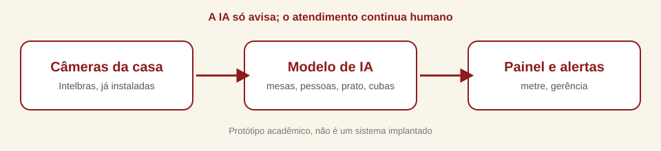
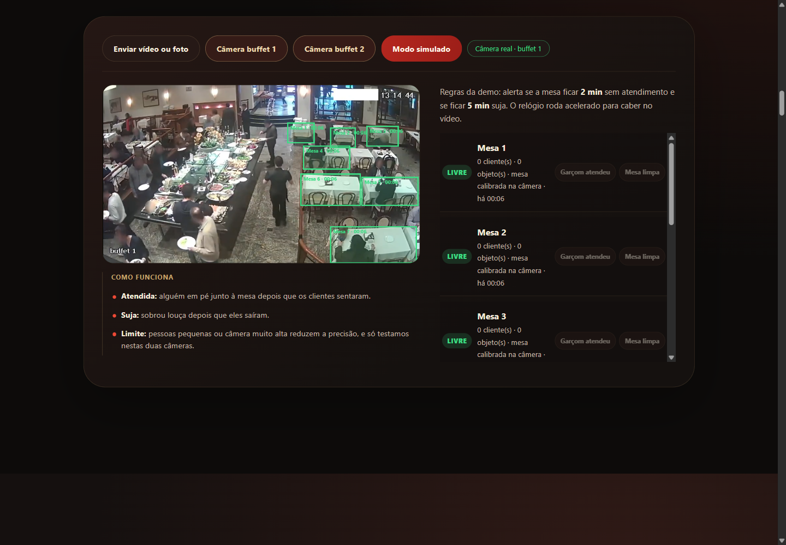

# Vendo o invisível

Projeto da equipe **BIG Tech** (**B**reno, **I**gor e **G**iovanna) no **Hackathon Tech FMU 2026.2**, para a Bovinu's Grill & Beer – Augusta (buffet por quilo).

> A casa já tem câmeras e um sistema de caixa, mas o salão não vira dado. Propomos **medir primeiro, decidir depois**, usando o que já existe.

| | |
|---|---|
| 🌐 **Site com as demos** | https://breno-sarcero.github.io/bigtech-fmu-2026-2/ |
| 🎬 **Vídeo (até 2 min)** | _link será adicionado aqui_ |
| 📑 **Slides (até 5)** | [`slides/apresentacao.pdf`](slides/apresentacao.pdf) |
| 📋 **Plano de instalação, rotas e custo** | [`docs/instalacao.md`](docs/instalacao.md) |

## O problema e a nossa resposta

| Dor da empresa | Resposta proposta |
|---|---|
| **Mix do prato:** o sistema sabe o peso, não o que está no prato | Câmera sobre cada balança; um modelo de IA analisa a foto junto com o peso |
| **Filas e tempo:** fila da churrasqueira até 4 min (ideal 2,5) e mesa esperando no pico | Simulação do pico com os números da casa e relógio por mesa com aviso ao metre |
| **Limpeza do salão:** mesa suja trava a próxima família | Modelo separa mesa em uso de mesa livre; alerta de limpeza |
| **Qualidade da comida:** falta dado de qual item acaba e quando | Câmera no buffet vê o nível de cada cuba e avisa a reposição |

O atendimento continua humano: a IA só avisa. Pagamento, cozinha, compras e estoque não são tocados.



## O que o protótipo faz

Tudo roda no navegador, sem enviar imagem a servidor.

- **Mesas:** duas câmeras reais da Bovinu's, modo simulado e envio de vídeo próprio.
- **Medido:** mesas ocupadas e pessoas em 4 cortes de 2 min (pico e fora do pico).
- **Fila e lotação:** simulação com os números da casa (618 clientes/dia, 450 lugares).
- **Mix do prato:** separação por cor sobre a foto, com peso e preço do quilo. Na proposta, o modelo de IA substitui a cor.
- **Cubas:** nível por cuba e série simulada de reposições.

Protótipo acadêmico: não é um sistema implantado. Veja o que é dado real, medição, simulação e premissa em [`docs/transparencia.md`](docs/transparencia.md).

## Capturas de tela do protótipo

Cinco telas do que criamos (site com as demos rodando no navegador). É um protótipo acadêmico, não um sistema implantado.

| | |
|---|---|
|  |  |
|  |  |
|  | |

## Como rodar

```bash
python -m http.server 8765          # na raiz do repositório
# abra http://localhost:8765/site/
node site/js/mesas-core.test.js     # testes da lógica (também fila-core e cubas-core)
```

## Estrutura

```
site/      protótipo web (HTML, CSS, JS, modelo ONNX e bibliotecas em vendor/)
docs/      plano de instalação, transparência, imagens e prints
ml/        scripts de treino e medição do modelo (veja ml/README.md)
slides/    apresentação em PDF
video/     vídeo de 2 minutos
```

## Como o modelo foi feito

Um **YOLOv8 nano** foi ajustado numa GTX 1650 com quadros dos vídeos cedidos, usando caixas geradas por um YOLOv8l (pseudo-rótulos). Resultado: mAP50 de **0,88** no teste. Foi exportado para **ONNX** e roda no navegador com onnxruntime-web. Detalhes em [`ml/README.md`](ml/README.md).

## Dados e licenças

- Os 4 cortes de vídeo em `site/video/` (2 min cada) vêm do material cedido pela Bovinu's, com rostos já borrados na origem. Os vídeos completos e os quadros de treino **não** estão aqui.
- O detector é **YOLOv8 (Ultralytics, AGPL-3.0)**. Uma implantação comercial exige revisar licenças.
- Bibliotecas: GSAP, TensorFlow.js com COCO-SSD e onnxruntime-web, cada uma com a própria licença.
