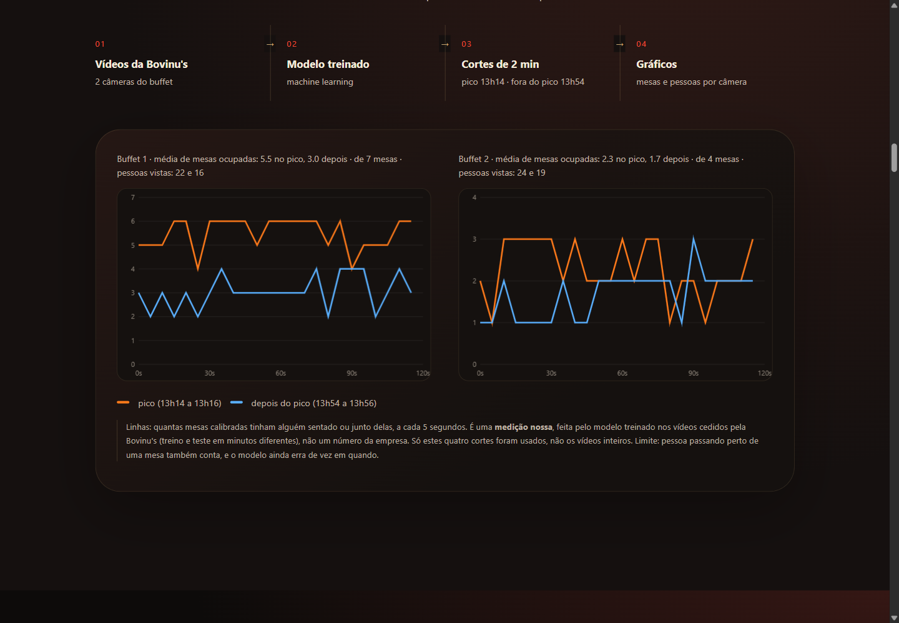
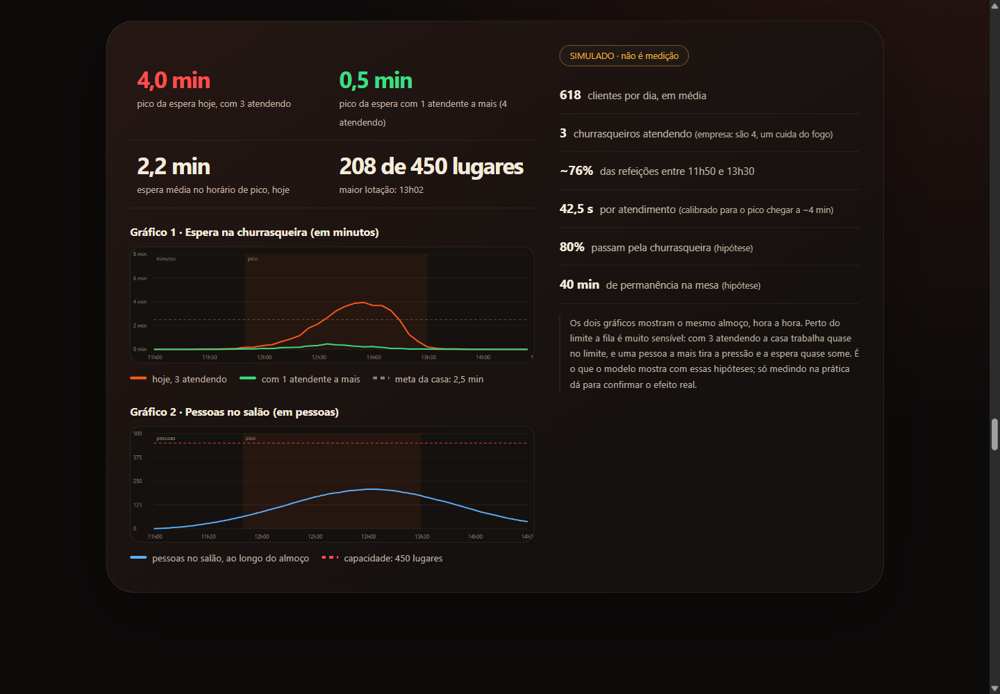
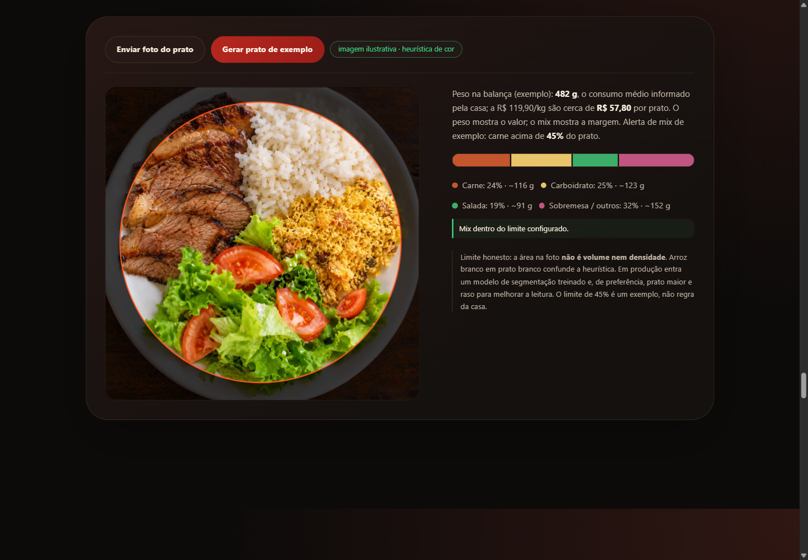
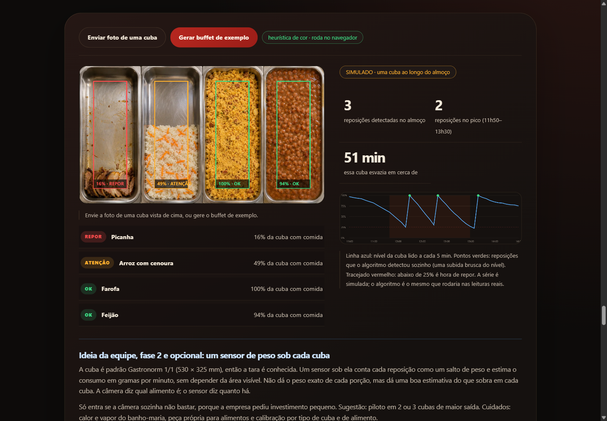

# Vendo o invisível — BIG Tech × Bovinu's (Augusta)

Projeto do **Hackathon Tech FMU 2026.2** para a Bovinu's Grill & Beer – Augusta (buffet por quilo). Equipe **BIG Tech**: **B**reno, **I**gor e **G**iovanna.

| | |
|---|---|
| **Site com as demos** | https://breno-sarcero.github.io/bigtech-fmu-2026-2/ |
| **Vídeo (até 2 min)** | _link será adicionado aqui_ |
| **Slides (até 5)** | [`slides/apresentacao.pdf`](slides/apresentacao.pdf) |
| **Plano de instalação, rotas e custo** | [`docs/instalacao.md`](docs/instalacao.md) |

## O problema

A casa já tem câmeras (Intelbras) e um sistema (JS Softcom), mas não extrai dado nenhum do salão. Sem dados concretos não dá para apontar onde estão os maiores problemas. Só a fila tem número da empresa (4 min, ideal 2,5). As quatro dores que a empresa citou:

1. **Mix do prato:** o sistema sabe o peso, não o que está no prato.
2. **Filas e tempo:** fila da churrasqueira acima do ideal e mesa esperando no pico.
3. **Limpeza do salão:** mesa que demora a ser limpa trava a próxima família.
4. **Qualidade da comida:** falta dado de qual item acaba, quando, e quanto tempo fica na cuba.

## A proposta

**Analisar primeiro, resolver depois.** Mostramos, com um protótipo funcionando, como medir o salão com o que a casa já tem, e propomos uma etapa de levantamento inicial antes de qualquer compra. O atendimento continua humano: a IA só avisa. Pagamento, cozinha, compras e estoque não são tocados.

| Dor | Nossa resposta |
|---|---|
| Mix do prato | Câmera sobre cada balança tira a foto quando o cliente se serve; cor + peso + preço do quilo |
| Filas e tempo | Simulação do pico com os números da casa e mais uma pessoa atendendo; relógio por mesa com aviso ao metre |
| Limpeza | Modelo treinado separa mesa em uso de mesa livre; tempo médio por praça e alerta de limpeza |
| Qualidade da comida | Câmera no buffet por imagem: onde há mais gente, nível de cada cuba, reposições |

## Capturas de tela

| | |
|---|---|
|  |  |
|  |  |
|  | |

## O que funciona (tudo roda no navegador, sem enviar imagem a servidor)

- **Mesas:** duas câmeras reais da Bovinu's (mesas calibradas por câmera), modo simulado animado e envio de vídeo próprio (marcando as mesas à mão). Estados: livre, aguardando, atendida, suja, com alerta de 2 min sem atendimento e 5 min suja.
- **Medido:** gráficos de mesas ocupadas e pessoas em **4 cortes de 2 minutos** (pico e fora do pico) das duas câmeras. Não processamos os vídeos inteiros.
- **Fila e lotação:** simulação de eventos discretos com os números da casa (618 clientes/dia, pico 11h50–13h30, 450 lugares).
- **Mix do prato:** separação por cor (carne, carboidrato, salada) sobre a foto, com o peso e o preço do quilo.
- **Cubas:** nível por cuba (calibrado pela cor do inox vazio) e série simulada de reposições.

## Como o modelo foi feito (machine learning)

1. Quadros dos dois vídeos cedidos pela Bovinu's (1 a cada 10 s, minutos de treino e de teste separados).
2. Um modelo grande (YOLOv8l) gerou as caixas de "pessoa" (pseudo-rótulos) em quadros 1280 px.
3. Um **YOLOv8 nano** foi ajustado (fine-tune) numa GTX 1650: mAP50 de **0,88** no conjunto de teste (concordância com o modelo grande, não com a verdade absoluta).
4. Exportado para **ONNX** e executado no navegador com onnxruntime-web (`site/models/`). Scripts em [`ml/`](ml/).

Uma segunda geração, treinada com o dobro de quadros, empatou na mesma validação (0,883 contra 0,880); mantivemos a primeira.

## Transparência: o que sabemos, medimos, simulamos e assumimos

- **Sabemos (da Bovinu's):** 618 clientes/dia de segunda a sexta, 482 g de consumo médio, R$ 119,90/kg, 450 lugares, pico 11h50–13h30, fila até 4 min (ideal 2,5), 3 de 4 churrasqueiros atendem, câmeras Intelbras e sistema JS Softcom em servidor local.
- **Medimos:** ocupação de mesas e pessoas nos 4 cortes. Não é número da empresa.
- **Simulamos (rotulado nas páginas):** fila, série das cubas, modo simulado das mesas, mix do prato por cor, marcações ilustrativas sobre quadros reais.
- **Assumimos:** quantas cubas há, integração com o JS Softcom (a casa não sabe se tem API), RTSP/ONVIF nas câmeras, que o modelo funcione fora destas duas câmeras.
- **Imagens:** os passos 01 e 03 do site usam quadros reais das câmeras com marcações por cima; as imagens dos passos 02 e 04 e os exemplos de prato e de cuba são **ilustrações geradas por IA**.
- Sem reconhecimento facial. A Bovinu's não endossa nem validou esta proposta.

## Rodar localmente

```bash
python -m http.server 8765        # na raiz do repositório
# abra http://localhost:8765/site/
node site/js/mesas-core.test.js   # testes da lógica (também fila-core e cubas-core)
```

## Estrutura

```
site/      página (HTML, CSS, JS, modelo ONNX e bibliotecas em vendor/)
docs/      plano de instalação (rotas A e B, custo, LGPD) e prints
ml/        scripts de rótulo, treino e medição do modelo
slides/    apresentação, roteiro do vídeo
```

## Dados e licenças

- Os **4 cortes de vídeo** em `site/video/` (2 min cada) vêm do material cedido pela Bovinu's para o hackathon, com rostos já borrados na origem. Os vídeos completos e os quadros de treino **não** estão neste repositório.
- O detector é **YOLOv8 (Ultralytics, AGPL-3.0)**; o código que o treina está em `ml/`. Uma implantação comercial exige revisar licenças e patentes.
- Bibliotecas: GSAP e ScrollTrigger (animação), TensorFlow.js e COCO-SSD (objetos de mesa), onnxruntime-web (modelo de pessoas). Cada uma segue a própria licença.
